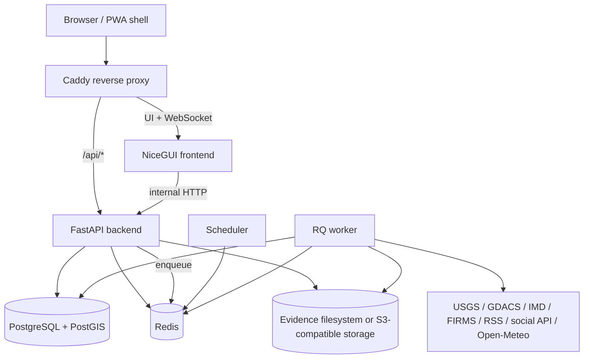
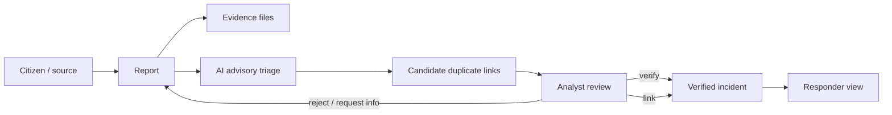

# Cignal architecture

## Deployment view

NiceGUI is a Python-authorable browser UI built on FastAPI components, but it is still a server-driven browser application and depends on a live client/server connection for the interactive dashboard. It abstracts the browser implementation; it does not eliminate browser technologies. See the [NiceGUI documentation](https://nicegui.io/documentation).

## Main application modules

- `app/ui/`: NiceGUI pages, reusable shell/components, HTTP API client and small browser configuration bridges.
- `app/api/`: FastAPI routes, Pydantic request schemas, authentication dependencies and role checks.
- `app/core/`: runtime configuration and cryptographic/authentication helpers.
- `app/db/`: SQLAlchemy entities, session lifecycle and PostGIS geometry trigger/index setup.
- `app/intelligence/`: CPU-friendly text triage, location extraction, candidate report similarity and optional image model adapter.
- `app/integrations/`: source-specific connectors that normalize upstream records into a common signal type.
- `app/services/`: auditing, notifications, realtime events and demo data seeding.
- `app/storage/`: evidence-storage interface with local filesystem and S3-compatible implementations.
- `app/worker.py`: asynchronous report processing, ingestion, retention and scheduled backups.
- `app/scheduler.py`: periodic source ingestion, daily retention and daily backup queueing.

## Core domain flow

A report is never silently merged into another report. `duplicate_of` is an advisory candidate reference. The `report_incidents` association table records many-to-many evidence relationships: one incident may be supported by multiple reports, and a report may be associated with an incident after human review.

## Database model

- `users`, `refresh_tokens`
- `reports`, `evidence`
- `incidents`, `report_incidents`
- `audit_logs`, `notifications`, `push_subscriptions`

Alembic manages schema revisions; the initial revision creates the SQLAlchemy metadata and application startup applies pending revisions before enabling the API. PostgreSQL stores portable latitude/longitude numeric fields. The startup initializer adds PostGIS `geometry(Point,4326)` columns, GiST indexes and triggers that maintain the geometry fields. SQLite is supported for isolated tests and local development, but PostGIS functionality is available only with PostgreSQL/PostGIS.

## Scale and deployment posture

This is a modular monolith at the application level, deployed as separate frontend, API, database, Redis, worker, scheduler and optional proxy containers. Boundaries are explicit without committing to microservice operations. The user's target of 100–500 concurrent users is an architectural goal, not a demonstrated capacity number. Benchmark the exact hardware, data rate, report/image upload size, NiceGUI WebSocket sessions, worker queue latency and database query patterns before making a capacity claim. A single workstation is not assumed to sustain that load.

## Ingestion telemetry and source-time semantics

Connector workers write per-source `IntegrationRun` telemetry before/after each attempt. Per-record validation failures do not discard valid records from the same feed. Only newly inserted reports are enqueued for analysis. Reports retain provider `source_observed_at` separately from Cignal `created_at`; temporal correlation prefers source event time when present and otherwise uses creation time.

## Analysis-generation safety and connector retry policy

Every report has a requested `analysis_revision` and successful `analyzed_revision`. Follow-up text and evidence uploads advance the requested revision through an atomic database-side increment. Analysis queue IDs include the revision. Workers reject obsolete jobs before doing work and re-check under a row lock before committing, so a slow analysis cannot overwrite a newer report generation. A partial index supports recovery of reports whose requested revision is newer than their analyzed revision.

Connector fetches use a bounded retry policy for transient transport/timeouts, HTTP 408/425/429 and 5xx responses. Exponential backoff includes jitter, respects a capped `Retry-After`, and records `fetch_attempts` in `IntegrationRun`. Malformed records and permanent client failures are not retried.

## Event intelligence boundary

Event hypotheses are distinct from verified Incidents. The Event Intelligence Engine v1 groups analyzed reports from multiple source origins using conservative spatial-temporal and pairwise similarity gates. It persists reversible report associations with component scores and reason codes. Discovery never creates or verifies an Incident; only the existing human review workflow may do that. See `docs/EVENT_INTELLIGENCE_V1.md` for the v1 algorithm, thresholds, API workflow and limitations.

Event Intelligence v2 adds an optional local-only multilingual embedding provider, an operator-trained event-pair ranker, append-only hypothesis snapshots and materialized source reliability profiles. Semantic embeddings are cached by report content digest and model version. The pair model is trained with event-group-disjoint holdout data and compared against the existing heuristic ranker; its output remains an uncalibrated ranking score. Source ingestion success and analyst association acceptance remain separate measurements and are not treated as proof of source truthfulness. See `docs/EVENT_INTELLIGENCE_V2.md`.

## Research data and model-development boundary

The Research Data Engine is downstream of ingestion and analyst event review.
It does not own provider connectors or decide event truth. `ResearchDataset`
records task/governance/source scope, `EventPairLabel` stores analyst labels and
review/provenance state, and `ResearchDatasetVersion` plus its items are immutable
training snapshots. The JSONL exporter verifies the stored SHA-256 and writes only
inside the existing shared model volume. Training and evaluation remain offline
commands using the event-pair pipeline; no training job is automatically started
by an API request.

## Research dataset governance

The Research Data Engine separates mutable source reports and label records from
immutable version-item snapshots. It stores label-time content fingerprints and
source provenance, enforces event-group leakage checks, and exports a canonical
JSONL payload plus a governance manifest into the shared model volume.

## Incident operations control plane

Verified incidents can own durable operational actions with assignment, priority, due dates, optimistic concurrency, approval gates and append-only action history. Life-safety action classes (public warnings, evacuation, resource dispatch and medical intervention) remain proposed until an administrator or analyst explicitly approves them. The application records authorization but does not itself transmit alerts or dispatch responders. See `docs/INCIDENT_OPERATIONS_V1.md`.

## Response orchestration

Verified incidents may receive an analyst-selected, versioned response coordination plan. Plan creation snapshots its template and creates durable action records plus prerequisite edges in one transaction. Server-side dependency checks gate action start; the plan status is derived from child task outcomes. Life-safety action types continue to require separate human approval. The orchestration layer does not publish warnings, dispatch resources or make emergency decisions. See `docs/INCIDENT_RESPONSE_ORCHESTRATION_V1.md`.

## Durable background-job delivery

Report-analysis requests are written to `background_job_outbox` in the same
SQL transaction as report creation, citizen follow-up, evidence changes, or
historical CSV import. The scheduler claims due requests with short leases and
uses deterministic RQ job IDs before marking rows `enqueued`. Expired leases
are reclaimable, dispatch failures back off exponentially, and exhausted
requests remain visible in a dead-letter state. This protects committed report
changes from transient Redis/RQ outages while preserving the existing
analysis-revision idempotency guard. See `docs/BACKGROUND_JOB_OUTBOX_V1.md`.

## Continuous cross-source event discovery

Analyzed, located reports from at least two distinct source origins are periodically
coalesced by the scheduler after a configurable quiet period. A deterministic
discovery generation key and a database unique index prevent duplicate scheduling
across scheduler replicas. The discovery run and its RQ dispatch intent are committed
atomically through the durable job outbox. Event hypotheses remain candidate-only;
continuous discovery never creates or verifies incidents and never issues warnings
or dispatches resources. See `docs/CONTINUOUS_EVENT_DISCOVERY_V1.md`.

## Event evolution execution scale

The event hypothesis clusterer uses a disaster-type and spatial grid over cluster anchors with time-based expiry. This is a conservative candidate prefilter; exact haversine, temporal, pair-score and complete-link checks remain authoritative. Historical replay freezes full membership only for hypotheses that overlap its immutable input set, then uses an inverted report-to-hypothesis index for Jaccard comparison. Existing input/window bounds and all human-review safeguards remain in place. See `docs/EVENT_EVOLUTION_SCALE_V1.md`.
